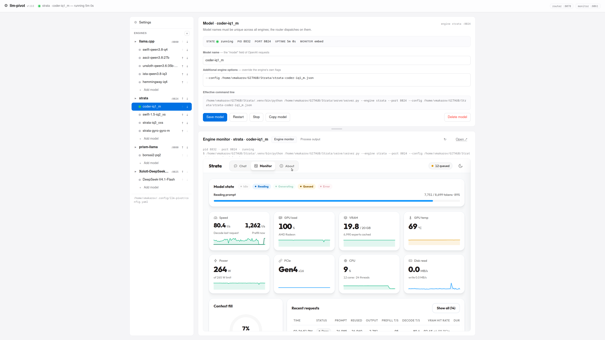

# llm-pivot

llm-pivot runs local LLM engines such as llama.cpp, strata and ninfer. It
routes OpenAI- or Anthropic-compatible requests to the engine configured for
each model and provides a web page for engine settings, controls and output.

Two ports:

| Port    | Default | Purpose                                             |
|---------|---------|-----------------------------------------------------|
| Monitor | `8061`  | Configure engines, start or stop models, view output  |
| Router  | `8078`  | Send OpenAI or Anthropic API requests |

Only one engine, serving one model, runs at a time. Requesting a different model stops
the current engine before starting the next one.

Most of llm-pivot was written by Claude Opus 5.

<a href="Monitor-Page.png">
  
</a>

## Quick start

Requires Go 1.26.6 or newer and a Unix-like system with process-group signals.
From the repository directory:

```sh
go build -o llm-pivot .
./llm-pivot
```

Open <http://127.0.0.1:8061>, set the engine command, and add a model. To access
llm-pivot from another machine, change the bind address in Settings and use
the server's address in the URL. On first start, llm-pivot creates
`~/.config/llm-pivot/config.yaml` by default. The web page is compiled into
the binary.

Point OpenAI-compatible clients at `http://127.0.0.1:8078/v1` and use the
configured model name. The router starts its engine automatically.

Anthropic clients use `http://127.0.0.1:8078` as their base URL. The router
recognizes each API automatically, so both clients can share the same port.
Anthropic Messages requests are translated to OpenAI Chat Completions for
the engine.

[Doc.md](Doc.md) contains detailed setup instructions, configuration and API
references, and troubleshooting advice.
